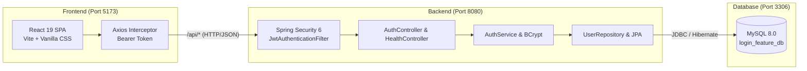

# Login Feature Development — Project Summary & Documentation

> **Project Name:** Login Feature Development (Intern Training Program)  
> **Repository:** [https://github.com/Anurag271213/Praveshika](https://github.com/Anurag271213/Praveshika)  
> **Version:** 1.0.0 (Production / Demo Ready)  
> **Status:** Fully Implemented, Tested, & Verified  

---

## 1. Executive Summary

This project delivers an end-to-end, production-grade **Authentication and Login System** built with **Spring Boot 3.3.4 (Java 21)**, **MySQL 8.0**, and a modern **React 19 (Vite)** single-page application.

It satisfies all five internship phases:
1. **Requirement Analysis:** Dual-login support (username/email), validation rules, error taxonomy.
2. **Technical Design:** RESTful architecture, layered backend structure, security filter chain.
3. **Implementation:** Spring Security 6 with BCrypt, JJWT HS512 tokens, React state & Axios interceptors.
4. **Testing:** 38 automated JUnit 5 / Spring Boot integration tests with 100% pass rate.
5. **Deployment & Demo:** Multi-process local orchestration, database seeding, and production builds.

---

## 2. Architecture & Tech Stack



### Technology Breakdown

| Layer | Technology | Key Dependencies / Features |
| :--- | :--- | :--- |
| **Backend** | Java 21 LTS, Spring Boot 3.3.4 | Spring Security 6, Spring Data JPA, Hibernate, JJWT `0.12.6`, Validation API |
| **Frontend** | React 19, Vite 5.4 | React Router 6.28, Axios 1.7.9, Custom Glassmorphic Design System |
| **Database** | MySQL 8.0 | InnoDB, `utf8mb4`, Indexed `username` and `email` |
| **Security** | Stateless JWT (HS512) | BCrypt (Cost factor 12), CORS enabled, CSRF disabled for stateless REST |

---

## 3. Database Schema

Database: `login_feature_db`

```sql
CREATE TABLE IF NOT EXISTS users (
    id BIGINT AUTO_INCREMENT PRIMARY KEY,
    username VARCHAR(50) NOT NULL UNIQUE,
    email VARCHAR(100) NOT NULL UNIQUE,
    password_hash VARCHAR(255) NOT NULL,
    enabled BOOLEAN NOT NULL DEFAULT TRUE,
    created_at TIMESTAMP DEFAULT CURRENT_TIMESTAMP,
    updated_at TIMESTAMP DEFAULT CURRENT_TIMESTAMP ON UPDATE CURRENT_TIMESTAMP,
    INDEX idx_users_username (username),
    INDEX idx_users_email (email)
) ENGINE=InnoDB DEFAULT CHARSET=utf8mb4 COLLATE=utf8mb4_unicode_ci;
```

---

## 4. Key Security & Functional Features

1. **Flexible Login Identification:** Authenticate via either **Username** (`admin`) or **Email** (`admin@example.com`).
2. **Password Validation & Hashing:**
   - Minimum 8 characters, at least 1 uppercase letter, 1 lowercase letter, 1 digit, and 1 special symbol (`@$!%*?&`).
   - Hashed using **BCryptPasswordEncoder** with cost factor 12.
3. **Stateless JWT Tokens:**
   - Cryptographically signed with HMAC-SHA512 (`HS512`).
   - Token payload contains user ID, issuer, issue date, and 24-hour expiration (`86400s`).
4. **Protected Route Protection:**
   - Client-side: `<PrivateRoute>` redirects unauthenticated visitors to `/login`.
   - Server-side: `JwtAuthenticationFilter` validates token on every request to `/api/auth/me`.
5. **Unified Error Handling:** Standardized `ApiErrorResponse` returned on 400 Bad Request, 401 Unauthorized, 403 Forbidden, and 500 Server Error.
6. **Automatic Seeding:** `DataInitializer` seeds a default admin account upon initial startup if not present.

---

## 5. REST API Endpoints

| Method | Endpoint | Access | Purpose | Success Code |
| :--- | :--- | :--- | :--- | :--- |
| `GET` | `/api/health` | Public | System liveness probe & timestamp | `200 OK` |
| `POST` | `/api/auth/login` | Public | Authenticate user & issue JWT token | `200 OK` |
| `POST` | `/api/auth/logout` | Public | Client token invalidation acknowledgment | `200 OK` |
| `GET` | `/api/auth/me` | Protected (`Bearer <token>`) | Get current authenticated user profile | `200 OK` |

### Sample Login Request & Response
- **Request (`POST /api/auth/login`):**
  ```json
  {
    "usernameOrEmail": "admin",
    "password": "Admin@123"
  }
  ```
- **Response (`200 OK`):**
  ```json
  {
    "success": true,
    "message": "Login successful",
    "token": "eyJhbGciOiJIUzUxMiJ9...",
    "tokenType": "Bearer",
    "expiresIn": 86400,
    "user": {
      "id": 1,
      "username": "admin",
      "email": "admin@example.com"
    }
  }
  ```

---

## 6. Default Demo Credentials

| Role | Username | Email | Password |
| :--- | :--- | :--- | :--- |
| **System Admin** | `admin` | `admin@example.com` | `Admin@123` |

---

## 7. Quick Start: How to Run

### Step 1: Start MySQL Database
Ensure MySQL 8.0 is running on port `3306` with database `login_feature_db`:
```bash
mysql -u root -p -e "CREATE DATABASE IF NOT EXISTS login_feature_db;"
mysql -u root -p login_feature_db < database/schema.sql
```

### Step 2: Start Backend Server
```bash
cd backend
# Using Maven Wrapper:
./mvnw clean spring-boot:run
# Or run packaged JAR:
java -jar target/login-feature-backend-1.0.0.jar
```
*Backend runs on `http://localhost:8080`.*

### Step 3: Start Frontend Dev Server
```bash
cd frontend
npm install
npm run dev
```
*Frontend runs on `http://localhost:5173` (proxies `/api` to `localhost:8080`).*

---

## 8. Automated Testing & Verification

All test suites executed with **100% pass rate**:
- `AuthControllerIntegrationTest`: 12 integration tests (valid login, invalid login, wrong password, email login, missing fields, protected route token check, invalid token rejection).
- `UserRepositoryIntegrationTest`: 10 database tests (CRUD, findByUsername, findByEmail, unique constraints).
- `JwtTokenProviderTest`: 15 unit tests (token generation, parsing, expiration, signature verification).
- `LoginFeatureApplicationContextTest`: Spring application context sanity test.
- **Total: 38 Tests Passed, 0 Failures, 0 Errors.**

---

## 9. Deliverables Directory Map

```text
.
├── backend/                  # Java Spring Boot 3.3.4 application
│   ├── src/main/java/        # Controllers, Services, Security, DTOs, Entities
│   ├── src/test/java/        # JUnit 5 Integration & Unit tests
│   └── pom.xml               # Maven dependencies & build configuration
├── frontend/                 # React 19 + Vite application
│   ├── src/pages/            # LoginPage.jsx, DashboardPage.jsx
│   ├── src/context/          # AuthContext.jsx
│   ├── src/api/              # axiosClient.js (with interceptor)
│   └── vite.config.js        # Vite build & reverse proxy config
├── database/
│   └── schema.sql            # MySQL schema & seed script
├── docs/
│   ├── Project-Summary.md    # This executive summary
│   ├── Requirement-Specification.md
│   ├── Technical-Design.md
│   ├── API-Documentation.md
│   ├── Deployment-Guide.md
│   ├── Test-Case-Execution-Sheet.md
│   └── Demo-Checklist.md
└── README.md                 # Complete project setup guide
```
